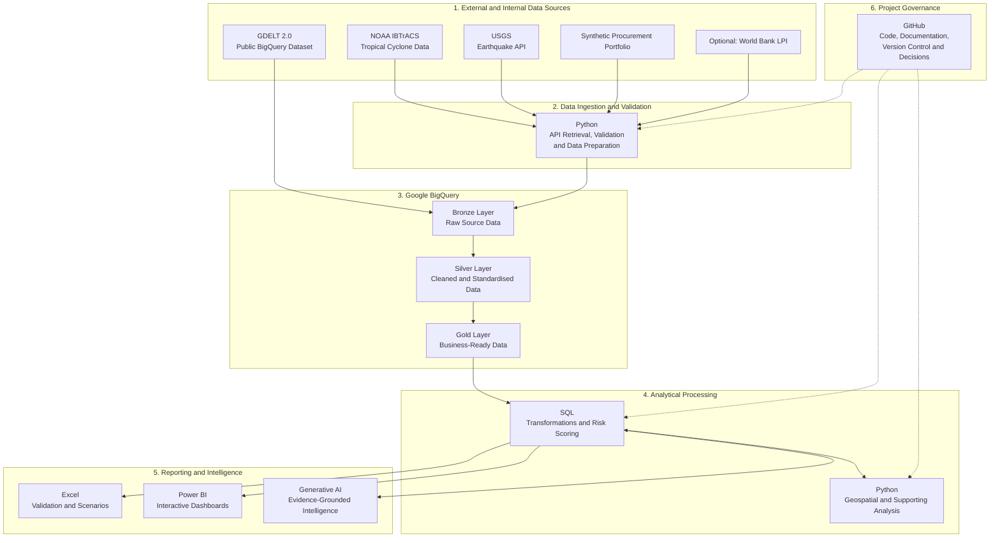

# SupplyChain Sentinel AI
## 03 — Solution Architecture

**Project:** Global Supply Chain Risk Intelligence & Decision Support Platform  
**Phase:** Phase 3 — Solution Architecture and Data Modelling  
**Status:** High-level architecture approved; detailed design in progress  
**Version:** 1.0

---

## 1. Purpose

This document defines the proposed high-level technical architecture for SupplyChain Sentinel AI.

It establishes how external data sources, ingestion processes, the data warehouse, analytical transformations, risk intelligence outputs and user-facing tools will work together.

The architecture is intended to provide a scalable, explainable and cost-conscious foundation for a supply-chain risk intelligence prototype.

This is an architectural design document, not evidence that the system has already been implemented.

## 2. Architectural Overview

The proposed architecture consists of six main areas:

1. External data sources
2. Data ingestion and validation
3. Central data warehouse
4. Data transformation and analytical processing
5. Reporting and intelligence interfaces
6. Documentation and version control

Google BigQuery will act as the central analytical data warehouse. Python will support ingestion and selected processing activities, while SQL will handle the primary warehouse transformations.

## 3. High-Level Architecture Diagram

**Diagram interpretation:** GDELT will be accessed directly through its existing public BigQuery dataset. NOAA, USGS and the synthetic procurement portfolio will use Python-supported ingestion into the project warehouse. Optional World Bank data will be included only if its eventual role and value are justified.

The exact extraction, persistence and transformation mechanisms will be defined in subsequent Phase 3 tasks.

## 4. Component Responsibilities

| Component | Primary responsibility |
|---|---|
| GDELT 2.0 | News-derived geopolitical events, event mentions and contextual intelligence |
| NOAA IBTrACS | Tropical cyclone observations and track information |
| USGS | Earthquake observations and associated metadata |
| Synthetic procurement portfolio | Hypothetical sourcing locations, procurement categories and exposure information |
| World Bank LPI | Optional historical logistics-performance context |
| Python | API ingestion, data validation, preparation, geospatial processing and supporting analysis |
| Google BigQuery | Central data warehouse and medallion architecture |
| SQL | Data transformations, standardisation, deduplication, matching, aggregation and risk scoring |
| Excel | Data reconciliation, validation, pivot-based analysis and scenario exploration |
| Power BI | Management dashboards, risk summaries and interactive investigation |
| Generative AI | Evidence-grounded summaries, explanations and investigation assistance |
| GitHub | Source code, technical documentation, project progress and version control |

## 5. Data Source Access Strategy

### 5.1 GDELT 2.0

GDELT is already available through Google's public BigQuery environment.

The project will query the relevant public tables directly rather than unnecessarily downloading and re-uploading the entire dataset.

Only the required, appropriately scoped data will be selected for project processing and persistence.

Key considerations:

- Use partition filters to control query costs.
- Preserve source identifiers and relevant source metadata.
- Apply the validation and deduplication rules established during Phase 2.
- Treat extracted events and themes as intelligence signals, not independently verified disruptions.
- Avoid assuming that multiple mentions or articles represent independent corroboration.

### 5.2 NOAA IBTrACS

Python will support retrieval and preparation of the required tropical cyclone data.

The ingestion process will retain relevant source identifiers, timestamps, geographical coordinates and source metadata.

Detailed field selection, update strategy and validation rules remain to be defined.

### 5.3 USGS Earthquake Catalog

Python will retrieve earthquake observations through the USGS API.

The process will preserve relevant event identifiers, observation timestamps, magnitude information, coordinates and source metadata.

The exact API parameters, retrieval window and incremental-update approach will be established during implementation planning.

### 5.4 Synthetic Procurement Portfolio

A hypothetical procurement portfolio will represent sourcing exposure across the project's selected countries, procurement categories and sourcing locations.

It will provide the business context required to associate external events and hazards with potential sourcing exposure.

The portfolio must always be identified as synthetic. It must not be represented as actual supplier relationships, commercial contracts or verified procurement transactions.

### 5.5 Optional World Bank LPI

World Bank Logistics Performance Index data may provide historical country-level logistics context.

It is not a live disruption-monitoring source and will not be treated as evidence of current operational conditions.

Its inclusion will depend on the final assessment of its relevance, version and integration requirements.

## 6. Central Data Warehouse — Google BigQuery

BigQuery will serve as the central analytical warehouse.

The proposed warehouse will follow the Medallion Architecture:

- **Bronze:** Source-aligned raw data and ingestion metadata.
- **Silver:** Cleaned, standardised, validated and deduplicated data.
- **Gold:** Curated business entities, analytical facts, dimensions and reporting outputs.

The detailed layer definitions, table inventory, data grain, keys and relationships will be documented separately in the subsequent Phase 3 design tasks.

No production Bronze, Silver or Gold implementation tables are authorised by this architecture approval alone.

## 7. Analytical Processing

### 7.1 SQL

SQL will be the primary language for warehouse-side processing.

Planned responsibilities include:

- Data standardisation and transformation.
- Duplicate and record-identity investigation.
- Event classification and normalisation.
- Geographic matching.
- Event-to-sourcing-location association.
- Aggregation and analytical modelling.
- Deterministic risk scoring.

### 7.2 Python

Python will support:

- External API ingestion.
- Data quality checks and validation.
- Data preparation and normalisation.
- Selected geospatial calculations.
- BigQuery integration.
- Supporting analytical tasks.
- Optional Generative AI integration.

SQL and Python will have clearly defined responsibilities to avoid unnecessary duplication of processing logic.

## 8. Reporting and Intelligence Interfaces

### 8.1 Excel

Excel will be used for supporting analytical work, including:

- Data reconciliation.
- Validation of selected warehouse outputs.
- Pivot-based analysis.
- Scenario exploration.
- Manual review of selected risk records.

Excel will not become an independent source of truth for the project's risk calculations.

### 8.2 Power BI

Power BI will provide the primary management-facing visualisation layer.

The proposed dashboard pages are:

1. Global Risk Overview
2. Geopolitical Intelligence
3. Natural Hazard Intelligence
4. Procurement Exposure
5. Event Investigation

The dashboards will consume curated warehouse outputs wherever practical.

### 8.3 Generative AI

Generative AI is intended to provide an additional intelligence interface.

Potential capabilities include:

- Summarising selected event evidence.
- Explaining why a location has been flagged for investigation.
- Producing evidence-grounded investigation briefs.
- Answering questions using approved analytical outputs.
- Optional read-only natural-language-to-SQL functionality.

Generative AI will not independently invent event evidence, alter deterministic risk scores or present unverified claims as facts.

A non-AI fallback must remain available if the proposed AI integration is not feasible.

## 9. Project Governance and Version Control

GitHub will act as the project's documentation and source-code repository.

It will contain:

- Project charter and requirements.
- Data source research and validation.
- Solution architecture and data modelling documentation.
- SQL scripts.
- Python scripts.
- Supporting Excel and Power BI documentation.
- Generative AI documentation.
- Research logs and decision records.
- Final project reports and supporting assets.

Architecture changes and important engineering decisions should be documented so that the final project report can trace the reasoning behind the implemented solution.

## 10. Architectural Design Principles

The following principles will guide subsequent design and implementation.

1. **Data provenance:** Retain source identifiers, source references and relevant ingestion metadata.
2. **Reproducibility:** Prefer documented, repeatable ingestion and transformation processes.
3. **Data quality:** Validate source structures, missing values, geographic fields and record identities before analytical use.
4. **Cost awareness:** Use partition pruning, scoped extraction and efficient warehouse queries.
5. **Separation of responsibilities:** Keep ingestion, warehouse transformation, analytical modelling and presentation responsibilities distinct.
6. **Explainability:** Ensure risk scores can be traced to their underlying inputs and calculations.
7. **Evidence-based intelligence:** Distinguish source observations from inferred exposure and potential risk.
8. **Synthetic-data transparency:** Clearly identify hypothetical procurement information.
9. **Controlled AI usage:** Restrict AI-generated outputs to evidence-grounded assistance and explanations.
10. **Version control:** Document changes to schemas, transformations, assumptions and analytical logic.

## 11. Important Risk and Interpretation Boundaries

SupplyChain Sentinel AI is a decision-support prototype, not a validated predictive disruption system.

The architecture must preserve the following distinctions:

- A geopolitical event does not automatically mean a supply-chain disruption occurred.
- A natural hazard near a sourcing location does not confirm damage or operational interruption.
- Geographic proximity is an exposure signal, not proof of supplier impact.
- News volume does not directly measure disruption severity.
- Risk scores are prioritisation indicators, not probabilities of supplier failure, shipment delay or financial loss.
- Synthetic procurement exposure must not be confused with actual commercial relationships.

## 12. Decisions Still Outstanding

The high-level architecture is approved, but several detailed engineering decisions remain open.

| Area | Outstanding decision |
|---|---|
| BigQuery | Project datasets, naming conventions and regional configuration |
| GDELT | Exact extraction scope and persistence strategy |
| NOAA | Retrieval format, update frequency and validation approach |
| USGS | API parameters, retrieval window and incremental loading strategy |
| Procurement | Synthetic portfolio structure and source format |
| Medallion | Detailed Bronze, Silver and Gold table inventory |
| Data modelling | Table grain, keys, relationships and fact/dimension definitions |
| Processing | Exact SQL and Python responsibility boundaries |
| Orchestration | Whether scheduling or automated orchestration is required |
| Reporting | Power BI connectivity and refresh strategy |
| Generative AI | Feasible provider, access method, cost and evaluation approach |
| Governance | Dataset access, credentials and operational controls |

These decisions will be resolved progressively in the remaining Phase 3 tasks rather than assumed prematurely.

## 13. Phase 3 Architecture Status

The high-level architecture has been reviewed and approved as the working design.

This approval establishes the architectural direction. It does not constitute approval of every detailed schema, pipeline, processing method or implementation decision.

The remaining Phase 3 activities will refine the architecture into a detailed and implementable technical design.

**Current status:** High-level architecture approved; formal documentation and subsequent detailed design work pending verification and approval.
